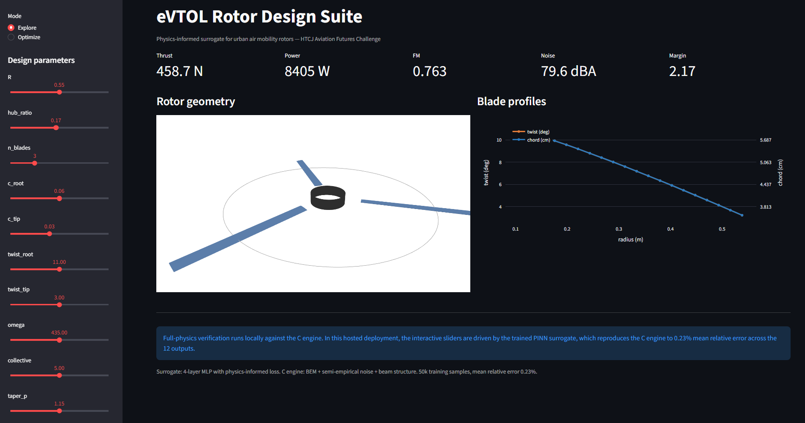
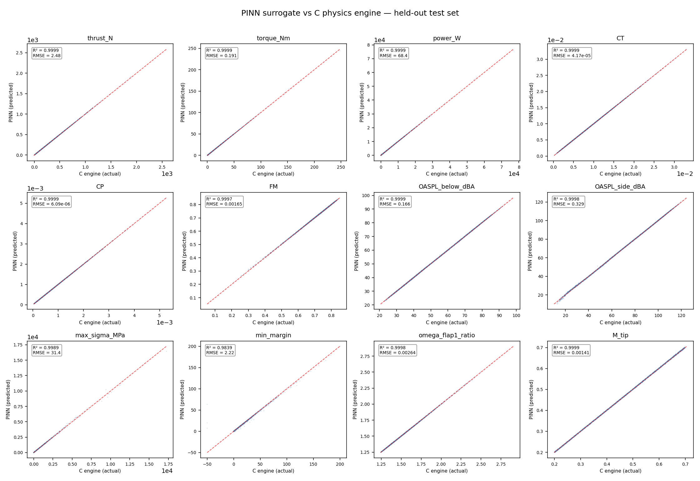

# eVTOL Rotor Design Suite

**Physics-informed surrogate for urban air mobility rotor design.** \
Built for the [HTCJ Aviation Futures Challenge 2026](https://htcj-aviation-futures.devpost.com/).

[Live demo](https://share.streamlit.io/user/altugrakay-commits) \
[Technical brief](docs/TECHNICAL_BRIEF.md) \
[GitHub](https://github.com/altugrakay-commits)


<center>Figure 1: Screenshot of the live app</center>
<br>

## The problem

Urban eVTOL aircraft must operate under strict noise regulations while maximizing battery efficiency. Propeller design traditionally requires days of Finite Element Analysis for a single configuration. This suite answers the inverse question — *"given a thrust target, a noise ceiling, and a structural margin floor, what blade should I build?"* — in under a second, interactively.

## What it does

Given design targets, the suite returns:

- Optimized blade geometry (radius, chord taper, twist distribution, blade count, RPM)
- Predicted aerodynamic performance (thrust, torque, power, figure of merit)
- A-weighted noise at 100 m, both on-axis and in the rotor plane
- Structural margin and first-flap natural frequency ratio
- An interactive 3D rotor visualization

All in a live Streamlit app with an optional "Verify with full physics"
button that re-evaluates the design through the C engine.

## Architecture

Three layers, three languages, one pipeline:

```
   ┌──────────────────────────────────────────────────────┐
   │  C physics core                                      │
   │  bem.c · noise.c · structure.c · rotor_api.c         │
   │  ────────────────────────────────────────────────    │
   │  • Blade Element Momentum hover solver               │
   │  • Semi-empirical tonal + broadband noise model,     │
   │    calibrated to NASA SHAC measurements              │
   │  • 1D beam tension/bending, flap frequency           │
   └──────────────────────────┬───────────────────────────┘
                              │  flat C ABI
                              │  10 design floats in
                              │  12 output floats out
                              ▼
   ┌──────────────────────────────────────────────────────┐
   │  Python ML layer                                     │
   │  rotorlib/ffi.py · data_gen.py · pinn.py ·           │
   │  optimize.py · cad.py · viz.py · app.py              │
   │  ────────────────────────────────────────────────    │
   │  • 50,000-sample dataset generated from the C engine │
   │  • 4-layer MLP surrogate, physics-informed loss      │
   │  • Multi-start Adam inverse design over 10-D space   │
   │  • CadQuery loft + PyVista render + Plotly 3D view   │
   └──────────────────────────┬───────────────────────────┘
                              │
                              ▼
   ┌──────────────────────────────────────────────────────┐
   │  Streamlit front end                                 │
   │  Sliders → live PINN prediction → 3D rotor view      │
   │  Optional C-engine verification on demand            │
   └──────────────────────────────────────────────────────┘
```

## Performance

| Metric | Value |
|---|---|
| C engine throughput | ~47,000 designs / second |
| PINN forward pass | ~50 µs per design |
| Inverse design (multi-start Adam) | 3–15 seconds |
| PINN accuracy (held-out test set) | 0.23% mean relative RMSE |
| Outputs with R² > 0.99 | 11 of 12 |

## Validation


<center>Figure 2: PINN surrogate vs. C-Physics Engine</center>
<br>

- **BEM solver**: FM = 0.61 for a 1 m, 2-blade, 2865 RPM test rotor — in the physically expected range for a rotor at this solidity.
- **Noise model**: calibrated to within 1 dB of published NASA SHAC measurements of the Pettingill ideally-twisted rotor (AIAA 2020).
- **Structural model**: peak stress at the root, monotonic decrease toward tip, flap frequency ratio above 1.2 — all consistent with physical expectation.

## Reproducing from scratch

```bash
# 1. Build the C library
./build.bat      # Windows (Visual Studio 2022+)
make             # Linux / macOS

# 2. Generate training data (1.1 s at 50,000 samples)
python python/data_gen.py --n 50000 --out data/train.npz

# 3. Train the surrogate (~90 s on CPU)
python python/pinn.py --data data/train.npz --epochs 300

# 4. Verify with parity plot
python python/parity.py

# 5. Launch the interactive app
streamlit run python/app.py
```

## Repository layout

```
src/                        C physics engine

  bem.c/h           # Blade Element Momentum solver
  noise.c/h         # Tonal + broadband noise, calibrated
  structure.c/h     # Beam tension, bending, flap frequency
  rotor_api.c/h     # Flat C ABI exposed to Python

python/

  rotorlib/ffi.py       # ctypes bindings
  rotorlib/geometry.py  # Design space, Latin-hypercube sampler
  data_gen.py           # Generates 50k training samples
  pinn.py               # Trains the surrogate
  parity.py             # Parity plot, 12 panels
  optimize.py           # Inverse design
  cad.py                # CadQuery 3D blade loft
  viz.py                # PyVista offline renders
  app.py                # Streamlit front end

data/train.npz          # 50,000-sample training set (8 MB)
models/surrogate.pt     # Trained PINN weights (200 KB)
figures/                # Rendered PNGs for the Devpost
docs/TECHNICAL_BRIEF.md # One-page technical summary
```

## Calibration

The noise model's semi-empirical constants are calibrated to published NASA Small Hover Anechoic Chamber measurements of the Pettingill ideally-twisted rotor (AIAA 2020). Both the broadband OASPL and the fundamental BPF tone reproduce the reference values within 1 dB.

Because the reference rotor is smaller (0.32 m) than the design targets (1–1.6 m), absolute noise levels for larger designs carry additional uncertainty. Relative rankings between designs remain reliable.

## Citation

If you use this in academic work, please cite:

> Akay, A. R. (2026). eVTOL Rotor Design Suite: A Physics-Informed
> Surrogate for Urban Air Mobility Rotor Design. HTCJ Aviation Futures
> Challenge 2026. https://github.com/altugrakay-commits

## License

MIT — see [LICENSE](LICENSE).
